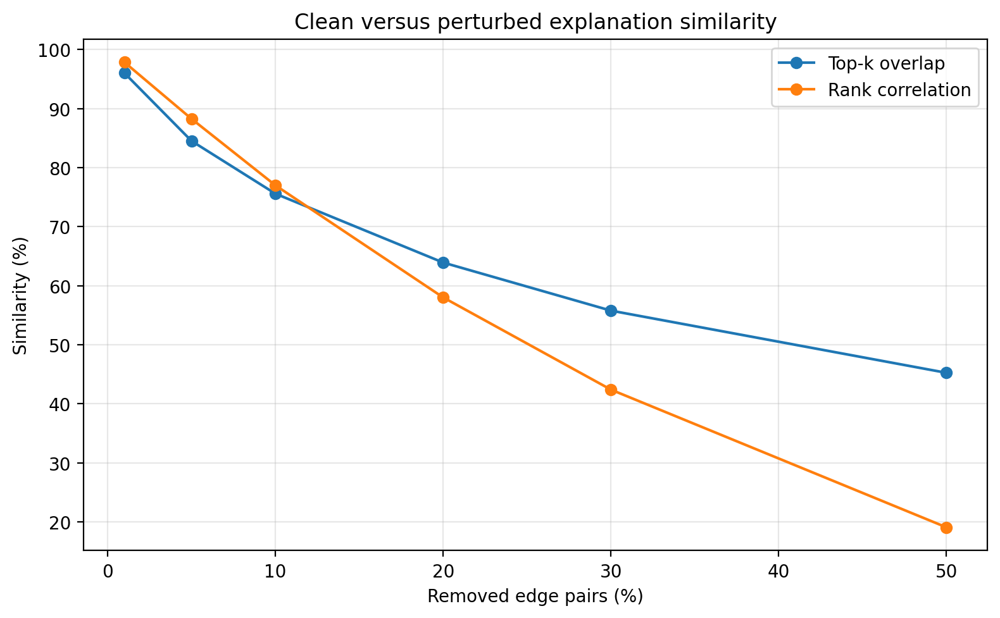
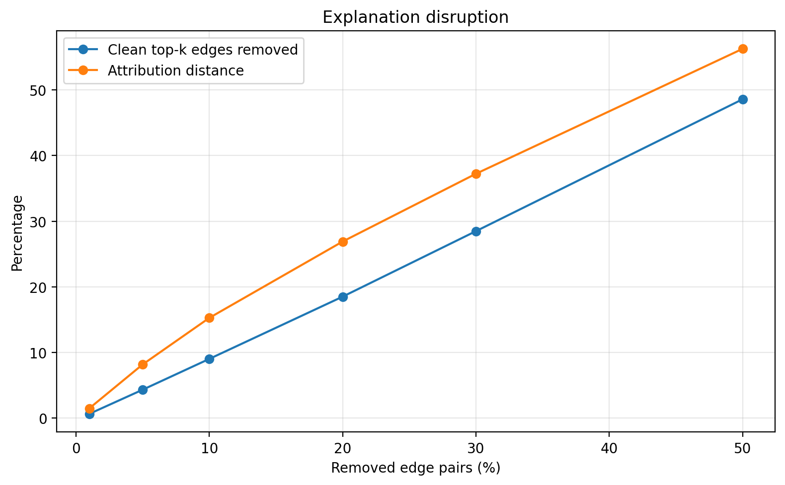
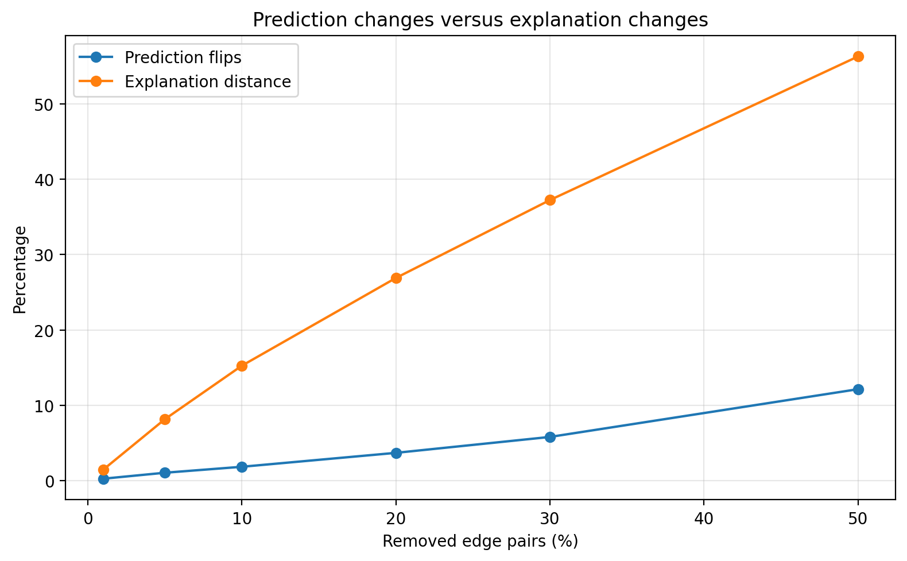
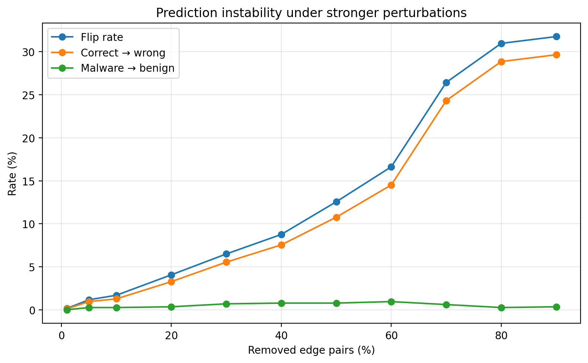

# CFG Perturbation and Explanation-Stability Study

**Status:** Preliminary results for discussion and review

## Executive summary

I used the already-trained CFG-GCN model to see how much its predictions and explanations change when CFG edges are removed. The classifier gets 92.61% accuracy on the 379 held-out CFGs (137 benign and 242 malicious). The main result is that the predictions are fairly stable under moderate changes, while the gradient-based explanations start changing much earlier.

At 20% edge-pair removal, prediction flips occur in 3.69% of cases, while top-k explanation overlap falls to 63.92%, rank correlation falls to 58.01%, and attribution distance reaches 26.89%. At 50% removal, explanation distance reaches 56.27%, while prediction flips remain at 12.14%.

This is the result I was mainly interested in: explanation instability seems to show up before prediction instability. At the same time, these are still random graph-space stress tests, so they should not be treated as valid, semantics-preserving PE attacks yet.

## 1. Motivation and research question

The idea behind this experiment is pretty simple: if a model classifies a CFG the same way after a small graph change, I would normally expect its explanation to remain reasonably similar too. If the prediction stays the same but the important edges change a lot, that could be a useful warning sign that the model is relying on unstable evidence.

The study asks:

1. How sensitive is the frozen classifier to random CFG edge perturbations?
2. How sensitive are its edge-level explanations to the same perturbations?
3. Does explanation instability appear before prediction instability?

## 2. Relation to prior work

The explanation part is based on the idea from Li et al. that a graph can be perturbed while the model still gives the same prediction, even though its explanation changes substantially. I am testing a similar idea here for CFG-based malware classification. For now, I used random edge removal as a first stress test rather than implementing a learned adversarial attack.

For the malware-security side, I also looked at Zapzalka et al., who used semantics-preserving node injection against GNN-based attributed CFG malware classifiers. Their perturbations are much closer to real executable-level attacks than the random edge deletions used here, so I am using that work as motivation rather than claiming that my current evasion results are directly comparable.

## 3. Experimental setup

### Dataset and split

I used CFGs from CIC-DGG-2025. To make sure I was evaluating samples that were not used for training, I reproduced the original deterministic split after filtering out the unusable CFG files. The resulting held-out set has 379 graphs.

### Frozen classifier

I loaded the existing CFG-GCN checkpoint and kept it frozen for all of the experiments. The model uses hashed opcode counts plus five structural node features: block size, instruction count, in-degree, out-degree, and whether the node is a simulated procedure. It has three GCN layers, global mean pooling, and a two-class classifier.

### Graph perturbation

Because the loader stores both directions of each CFG edge, I removed complete undirected edge pairs instead of removing only one direction. The stronger stress test covered 1% through 90% edge-pair removal with five random repeats. These edits were made directly to the graph objects; I did not modify or regenerate the underlying PE files.

### Explanation method

For the first explanation experiment, I used gradient-based edge saliency. I treated the edge weights as differentiable inputs, calculated the absolute gradient of the selected target-class logit, and combined the two directions of each CFG edge. I used the same target class for the clean and perturbed graphs so that the comparison measured explanation change rather than a change in the target being explained.

The explanation comparisons include:

- Top-k edge overlap
- Spearman rank correlation of edge importance
- Cosine similarity of attribution vectors
- Attribution L1 distance
- Fraction of clean top-k edges removed by perturbation
- Prediction flips for comparison with explanation changes

## 4. Clean classification results

| Metric | Result |
|---|---:|
| Clean accuracy | 92.61% |
| Benign accuracy | 86.86% |
| Malware accuracy | 95.87% |
| Held-out CFGs | 379 |

The clean model performs better on malicious graphs than benign graphs in this split, with the largest baseline error contribution coming from benign samples classified as malicious.

## 5. Prediction robustness under edge removal

```text
Removed edge pairs Prediction flips Correct to wrong Malware to benign Edges retained Mean components Largest component Delta confidence
                1%            0.16%            0.11%             0.00%         99.36%          1.6406            98.28%          +0.0002
                5%            1.16%            0.95%             0.26%         95.81%          5.3119            94.17%          +0.0029
               10%            1.69%            1.27%             0.26%         91.01%         12.3351            89.38%          +0.0069
               20%            4.06%            3.27%             0.34%         81.37%         38.0195            76.11%          +0.0131
               30%            6.49%            5.54%             0.69%         71.53%         85.2206            59.33%          +0.0190
               40%            8.76%            7.55%             0.78%         60.94%        160.1989            40.75%          +0.0208
               50%           12.56%           10.77%             0.78%         50.90%        263.2454            25.02%          +0.0231
               60%           16.62%           14.51%             0.95%         41.56%        387.4222            15.86%          +0.0107
               70%           26.44%           24.33%             0.60%         31.10%        523.7720            10.80%          +0.0076
               80%           30.98%           28.87%             0.26%         21.13%        666.5256             8.17%          +0.0363
               90%           31.77%           29.66%             0.34%         11.61%        812.2459             6.52%          +0.0424
```

At the strongest tested perturbation (90% edge-pair removal), 31.77% of evaluations flipped. The malware-to-benign rate was only 0.34%, while the graphs were structurally heavily fragmented: the mean number of connected components was 812.2 and the largest component contained only 6.52% of nodes.

Thus, the random edge-removal experiment produces increasing classifier instability only after substantial graph destruction, and the observed flips are predominantly not malware-evasion flips.

## 6. Explanation stability results

```text
Removed edge pairs Prediction flips Top-k overlap Rank correlation Cosine similarity Attribution distance Clean top-k removed
                1%            0.26%        96.02%           97.84%            99.41%                1.46%               0.62%
                5%            1.06%        84.51%           88.26%            95.86%                8.15%               4.30%
               10%            1.85%        75.58%           76.99%            91.06%               15.25%               9.00%
               20%            3.69%        63.92%           58.01%            82.39%               26.89%              18.49%
               30%            5.80%        55.77%           42.39%            73.75%               37.22%              28.47%
               50%           12.14%        45.24%           19.07%            57.67%               56.27%              48.58%
```

At 10% removal, prediction flips occur in only 1.85% of evaluations, but top-k overlap is already 75.58% and rank correlation is 76.99%. At 20% removal, attribution distance reaches 26.89%, while prediction flips remain at 3.69%.

At 50% removal, only 45.24% of top-k edges overlap and rank correlation falls to 19.07%. The attribution distance is 56.27%, compared with a prediction-flip rate of 12.14%.

The clearest pattern is that the explanations degrade faster than the predictions. That makes explanation instability worth investigating as a possible model-reliability signal, but it does not prove that a sample was intentionally modified or adversarial.

## 7. Figures









## 8. Limitations

- The perturbations are graph-space edits and are not guaranteed to preserve PE validity, program semantics, or executable behavior.
- Edge removal is random rather than optimized against the classifier or explainer.
- The current explanation method is gradient-based edge saliency, not a full GNNExplainer or attack optimized specifically to alter explanations.
- The explanation experiment used one random perturbation per graph and perturbation level, so its reported averages do not estimate repeated-perturbation variance.
- The classifier checkpoint and split are fixed, but the current experiment does not establish performance across multiple seeds or independently trained models.
- Severe perturbation levels, especially 50% and above, create highly fragmented graphs and should be interpreted as stress tests rather than realistic attacks.

## 9. Future work

The next step is mainly to get access to the HPC lab so I can run the experiments more comfortably and try more expensive explanation and perturbation methods. I also want to get access to real malicious samples and repeat the experiment with more realistic CFGs instead of relying only on the current dataset and graph-space stress tests.

## References

[1] J. Li, M. Pang, Y. Dong, J. Jia, and B. Wang, “Graph Neural Network Explanations are Fragile,” *Proceedings of the 41st International Conference on Machine Learning*, PMLR vol. 235, pp. 28551–28567, 2024. [Publisher page](https://proceedings.mlr.press/v235/li24bd.html).

[2] D. Zapzalka, S. Salem, and D. Mohaisen, “Semantics-Preserving Node Injection Attacks Against GNN-Based ACFG Malware Classifiers,” *IEEE Transactions on Dependable and Secure Computing*, vol. 22, no. 1, pp. 549–560, 2025. DOI: [10.1109/TDSC.2024.3409410](https://doi.org/10.1109/TDSC.2024.3409410).

[3] G. Higgins, R. Razavi-Far, H. Shokouhinejad, and A. A. Ghorbani, “Transparent Malware Detection With Granular Assembly Flow Explainability via Graph Neural Networks,” arXiv:2601.14511, 2026. DOI: [10.48550/arXiv.2601.14511](https://doi.org/10.48550/arXiv.2601.14511).
