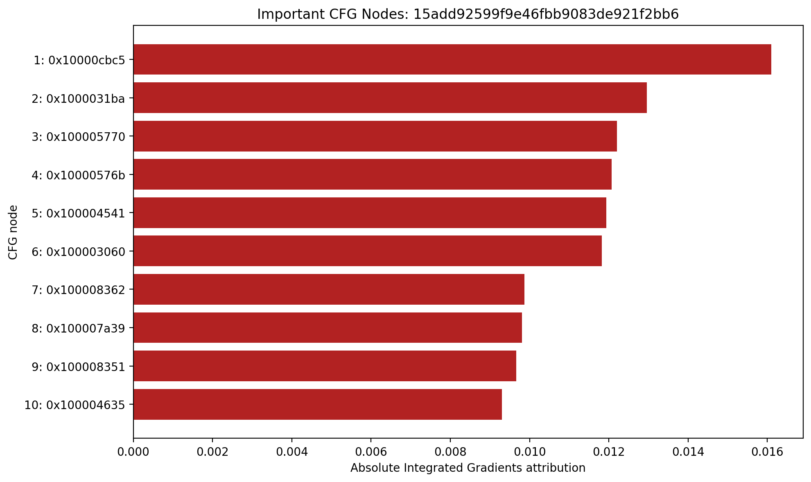
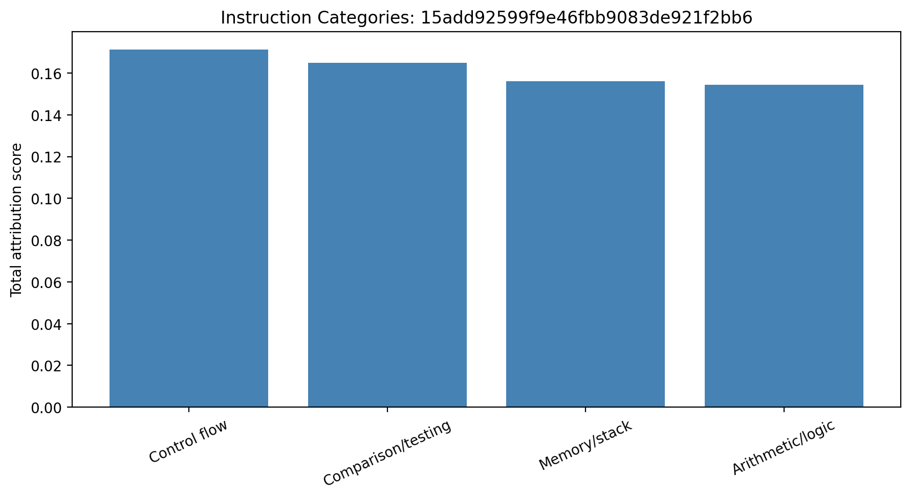
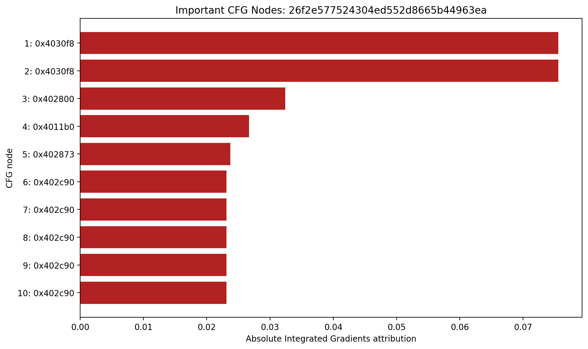
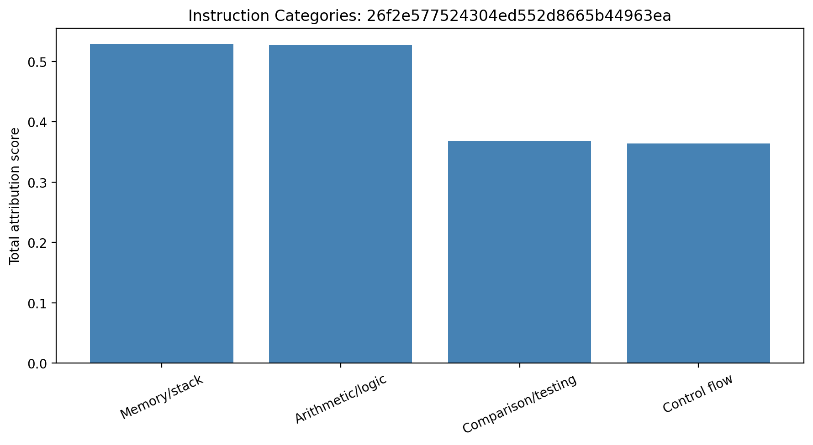
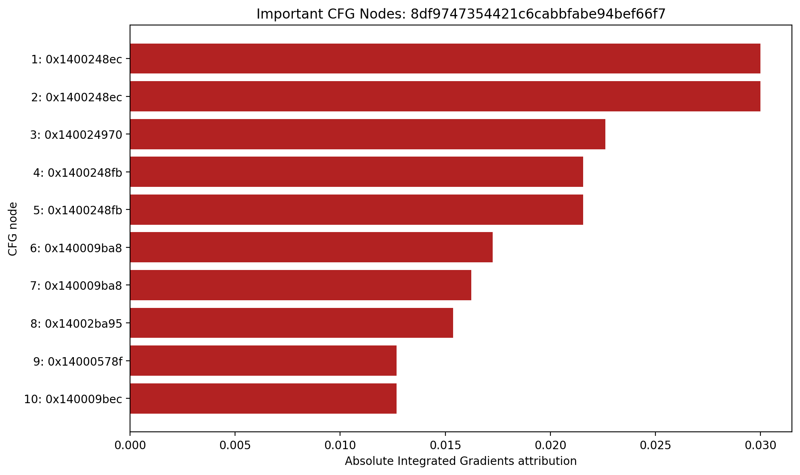
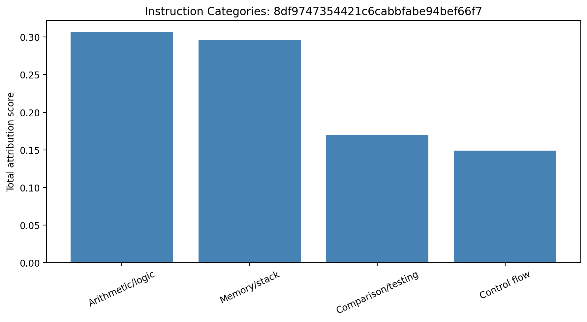
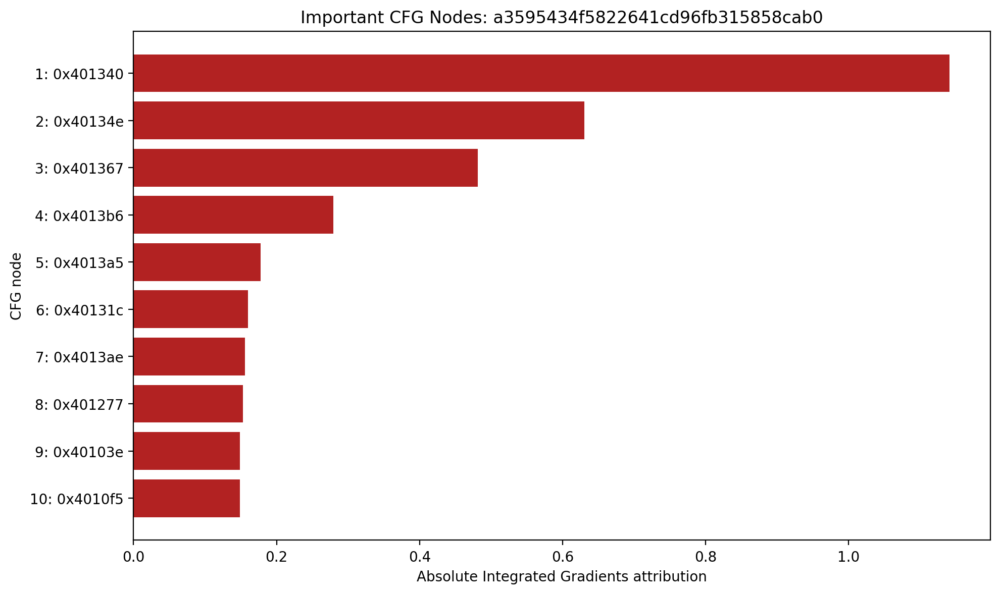
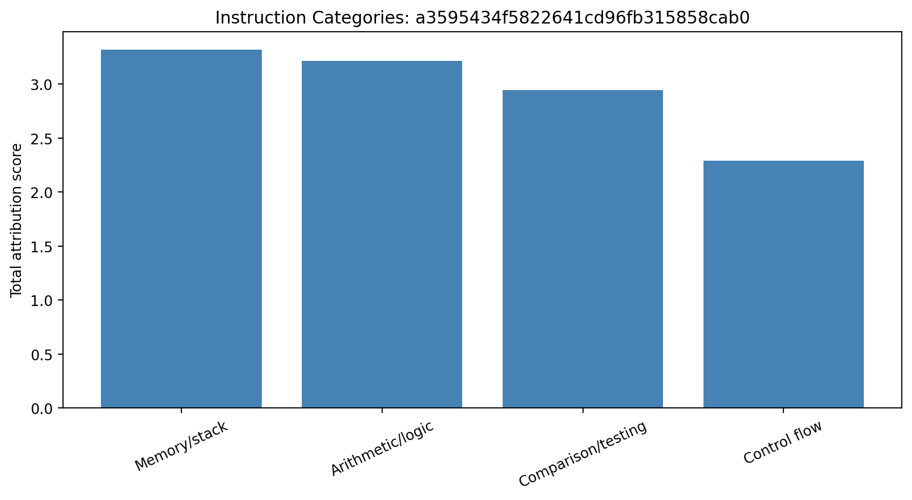

# Integrated Gradients Explanation Report

The scores below are absolute Integrated Gradients attributions aggregated over the features of each CFG node. Higher values indicate greater influence on the model's selected prediction.

These explanations describe model reliance, not causal evidence that an instruction is malicious.

## Sample `15add92599f9e46fbb9083de921f2bb6`

**Interpretation:** The model relied heavily on control-flow operations such as calls, returns, or branches. Secondary attributed categories were: Comparison/testing, Memory/stack. This describes which instruction regions influenced the model prediction; it does not prove that those instructions are malicious.

### Top attributed nodes

| Rank | Address | Score | Instructions |
|---:|---|---:|---|
| 1 | `0x10000cbc5` | 0.016099 | `mov r11, qword ptr [rsp + 0x38] ; xor r11, rbx ; movabs rax, 0xffffffffffff ; and r11, rax ; movabs rax, 0x2b992ddfa233 ; cmp r11, rdi ; cmove r11, rax ; mov qword ptr [rip + 0x250e], r11 ; not r11 ; mov qword ptr [rip + 0x250c], r11 ; mov rbx, qword ptr [rsp + 0x40] ; add rsp, 0x20 ; pop rdi ; ret` |
| 2 | `0x1000031ba` | 0.012955 | `mov eax, ebp ; seta al ; mov dword ptr [rsp + rcx + 0x30], eax ; add rcx, 4 ; add rdx, 0x18 ; cmp rcx, 8 ; jl 0x100003182` |
| 3 | `0x100005770` | 0.012209 | `or edi, dword ptr [rsp + 0x2e0] ; lea r8, [rip + 0xae5a] ; mov rdx, rsi ; or edi, dword ptr [rsp + 0x2e8] ; mov rcx, r13 ; bts edi, 0x10 ; mov r9d, edi ; call qword ptr [rip - 0x4428]` |
| 4 | `0x10000576b` | 0.012076 | `mov edi, 0x180000 ; or edi, dword ptr [rsp + 0x2e0] ; lea r8, [rip + 0xae5a] ; mov rdx, rsi ; or edi, dword ptr [rsp + 0x2e8] ; mov rcx, r13 ; bts edi, 0x10 ; mov r9d, edi ; call qword ptr [rip - 0x4428]` |
| 5 | `0x100004541` | 0.011941 | `mov eax, ebx ; seta al ; cmp edx, ebx ; mov ebp, 0x104 ; jl 0x10000465c` |
| 6 | `0x100003060` | 0.011820 | `mov qword ptr [rsp + 0x18], rbx ; mov qword ptr [rsp + 0x20], r9 ; mov qword ptr [rsp + 0x10], rdx ; push rbp ; push rsi ; push rdi ; push r12 ; push r13 ; push r14 ; push r15 ; sub rsp, 0x40 ; xor ebp, ebp ; mov rsi, rdx ; mov r12, rcx ; cmp dword ptr [rcx + 0x7c], ebp ; mov rbx, rbp ; mov r14d, ebp ; mov r13d, ebp ; jle 0x100003230` |
| 7 | `0x100008362` | 0.009874 | `add al, 0xe0 ; movsx edx, al ; sub edx, 0x37 ; lea eax, [rdx - 0xa] ; cmp eax, 5 ; ja 0x100008382` |
| 8 | `0x100007a39` | 0.009804 | `mov eax, dword ptr [rsp + 0x30] ; lea r9, [rip + 0x9bde] ; mov r8, r14 ; add eax, edi ; mov rdx, r9 ; cdqe ; sub rax, r9 ; lea rcx, [rsp + rax + 0x40] ; lea rax, [r8 + 0x7ffffefa] ; cmp rax, r12 ; je 0x100007a74` |
| 9 | `0x100008351` | 0.009669 | `add edi, -3 ; movsx eax, al ; shl edi, 4 ; add edi, eax ; jmp 0x100008377` |
| 10 | `0x100004635` | 0.009299 | `mov r9d, ebx ; or r9d, ebp ; lea r8, [rip + 0xbf96] ; mov rdx, rsi ; or r9d, 0x30 ; xor ecx, ecx ; call qword ptr [rip - 0x32e1]` |

## Sample `26f2e577524304ed552d8665b44963ea`

**Interpretation:** The model relied heavily on memory-access and stack-manipulation instructions. Secondary attributed categories were: Arithmetic/logic, Comparison/testing. This describes which instruction regions influenced the model prediction; it does not prove that those instructions are malicious.

### Top attributed nodes

| Rank | Address | Score | Instructions |
|---:|---|---:|---|
| 1 | `0x4030f8` | 0.075563 | `nop ; nop ; nop ; nop ; nop ; nop ; nop ; nop ; sub rsp, 0x28 ; mov eax, dword ptr [rcx] ; cmp eax, 0xc0000091 ; ja 0x403170` |
| 2 | `0x4030f8` | 0.075562 | `nop ; nop ; nop ; nop ; nop ; nop ; nop ; nop ; sub rsp, 0x28 ; mov eax, dword ptr [rcx] ; cmp eax, 0xc0000091 ; ja 0x403170` |
| 3 | `0x402800` | 0.032400 | `push r12 ; push rbp ; push rdi ; push rsi ; push rbx ; sub rsp, 0x40 ; mov rbx, qword ptr [rip + 0x186f] ; movabs rax, 0x2b992ddfa232 ; mov qword ptr [rsp + 0x20], 0 ; cmp rbx, rax ; je 0x402840` |
| 4 | `0x4011b0` | 0.026713 | `push r13 ; push r12 ; push rbp ; push rdi ; push rsi ; push rbx ; sub rsp, 0x98 ; mov rbp, qword ptr [rip + 0x46fa] ; xor eax, eax ; mov ecx, 0xd ; lea rdx, [rsp + 0x20] ; mov r9d, dword ptr [rbp] ; mov rdi, rdx ; rep stosq qword ptr [rdi], rax` |
| 5 | `0x402873` | 0.023728 | `xor r12, qword ptr [rsp + 0x30] ; mov edx, edi ; movabs rax, 0xffffffffffff ; xor rbp, r12 ; mov rdi, rbp ; xor rdi, rdx ; mov edx, esi ; xor rdi, rdx ; mov rsi, rdi ; and rsi, rax ; cmp rsi, rbx ; je 0x4028c0` |
| 6 | `0x402c90` | 0.023141 | `push r13 ; push r12 ; push rbp ; push rdi ; push rsi ; push rbx ; sub rsp, 0x58 ; movsxd rbp, dword ptr [rip + 0x5a21] ; mov rbx, rcx ; mov rsi, rdx ; mov rdi, r8 ; test ebp, ebp ; jle 0x402daa` |
| 7 | `0x402c90` | 0.023140 | `push r13 ; push r12 ; push rbp ; push rdi ; push rsi ; push rbx ; sub rsp, 0x58 ; movsxd rbp, dword ptr [rip + 0x5a21] ; mov rbx, rcx ; mov rsi, rdx ; mov rdi, r8 ; test ebp, ebp ; jle 0x402daa` |
| 8 | `0x402c90` | 0.023139 | `push r13 ; push r12 ; push rbp ; push rdi ; push rsi ; push rbx ; sub rsp, 0x58 ; movsxd rbp, dword ptr [rip + 0x5a21] ; mov rbx, rcx ; mov rsi, rdx ; mov rdi, r8 ; test ebp, ebp ; jle 0x402daa` |
| 9 | `0x402c90` | 0.023138 | `push r13 ; push r12 ; push rbp ; push rdi ; push rsi ; push rbx ; sub rsp, 0x58 ; movsxd rbp, dword ptr [rip + 0x5a21] ; mov rbx, rcx ; mov rsi, rdx ; mov rdi, r8 ; test ebp, ebp ; jle 0x402daa` |
| 10 | `0x402c90` | 0.023138 | `push r13 ; push r12 ; push rbp ; push rdi ; push rsi ; push rbx ; sub rsp, 0x58 ; movsxd rbp, dword ptr [rip + 0x5a21] ; mov rbx, rcx ; mov rsi, rdx ; mov rdi, r8 ; test ebp, ebp ; jle 0x402daa` |

## Sample `8df9747354421c6cabbfabe94bef66f7`

**Interpretation:** The model relied heavily on arithmetic and bitwise operations. Secondary attributed categories were: Memory/stack, Comparison/testing. This describes which instruction regions influenced the model prediction; it does not prove that those instructions are malicious.

### Top attributed nodes

| Rank | Address | Score | Instructions |
|---:|---|---:|---|
| 1 | `0x1400248ec` | 0.030009 | `movzx r8d, bp ; lea r9, [rsp + 0x20] ; mov r10d, 0x10 ; movzx ecx, r8w ; add r8w, r13w ; movzx eax, byte ptr [rcx + rbx + 0x1a] ; movzx edx, byte ptr [rcx + rbx + 0x1b] ; shl edx, 8 ; or edx, eax ; movzx eax, byte ptr [rcx + rbx + 0x19] ; shl edx, 8 ; or edx, eax ; movzx eax, byte ptr [rcx + rbx + 0x18] ; shl edx, 8 ; or edx, eax ; mov dword ptr [r9], edx ; add r9, r13 ; sub r10, r12 ; jne 0x1400248fb` |
| 2 | `0x1400248ec` | 0.030007 | `movzx r8d, bp ; lea r9, [rsp + 0x20] ; mov r10d, 0x10 ; movzx ecx, r8w ; add r8w, r13w ; movzx eax, byte ptr [rcx + rbx + 0x1a] ; movzx edx, byte ptr [rcx + rbx + 0x1b] ; shl edx, 8 ; or edx, eax ; movzx eax, byte ptr [rcx + rbx + 0x19] ; shl edx, 8 ; or edx, eax ; movzx eax, byte ptr [rcx + rbx + 0x18] ; shl edx, 8 ; or edx, eax ; mov dword ptr [r9], edx ; add r9, r13 ; sub r10, r12 ; jne 0x1400248fb` |
| 3 | `0x140024970` | 0.022626 | `mov rax, rsp ; mov qword ptr [rax + 0x10], rbx ; mov qword ptr [rax + 0x18], rbp ; mov qword ptr [rax + 0x20], rsi ; mov qword ptr [rax + 8], rcx ; push rdi ; push r12 ; push r13 ; push r14 ; push r15 ; mov r10d, dword ptr [rcx + 4] ; mov r11d, dword ptr [rcx + 8] ; mov r9d, dword ptr [rcx + 0xc] ; mov ecx, dword ptr [rcx] ; mov rsi, rdx ; mov r8d, r10d ; mov r13d, dword ptr [rsi + 0x1c] ; not r8d ; mov eax, r11d ; and eax, r10d ; and r8d, r9d ; or r8d, eax ; mov eax, r10d ; add r8d, dword ptr [rdx] ; lea edx, [r8 + rcx - 0x28955b88] ; rol edx, 7 ; add edx, r10d ; and eax, edx ; mov ecx, edx ; not ecx ; and ecx, r11d ; or ecx, eax ; add ecx, dword ptr [rsi + 4] ; lea r8d, [rcx + r9 - 0x173848aa] ; rol r8d, 0xc ; add r8d, edx ; mov ecx, r8d ; mov eax, r8d ; not ecx ; and eax, edx ; and ecx, r10d ; or ecx, eax ; mov eax, r8d ; add ecx, dword ptr [rsi + 8] ; lea r9d, [rcx + r11 + 0x242070db] ; ror r9d, 0xf ; add r9d, r8d ; and eax, r9d ; mov ecx, r9d ; not ecx ; and ecx, edx ; or ecx, eax ; mov eax, r9d ; add ecx, dword ptr [rsi + 0xc] ; lea r10d, [rcx + r10 - 0x3e423112] ; ror r10d, 0xa ; add r10d, r9d ; and eax, r10d ; mov ecx, r10d ; not ecx ; and ecx, r8d ; or ecx, eax ; mov eax, r10d ; add ecx, dword ptr [rsi + 0x10] ; lea r11d, [rcx + rdx - 0xa83f051] ; rol r11d, 7 ; add r11d, r10d ; and eax, r11d ; mov ecx, r11d ; not ecx ; and ecx, r9d ; or ecx, eax ; add ecx, dword ptr [rsi + 0x14] ; lea edx, [rcx + r8 + 0x4787c62a] ; rol edx, 0xc ; add edx, r11d ; mov ecx, edx ; mov eax, edx ; not ecx ; and eax, r11d ; and ecx, r10d ; or ecx, eax ; mov eax, edx ; add ecx, dword ptr [rsi + 0x18] ; lea r8d, [rcx + r9 - 0x57cfb9ed] ; ror r8d, 0xf ; add r8d, edx ; mov ecx, r8d ; not ecx ; and ecx, r11d ; and eax, r8d ; or ecx, eax ; mov r14d, dword ptr [rsi + 0x28] ; mov r12d, dword ptr [rsi + 0x30] ; add ecx, r13d ; mov r15d, dword ptr [rsi + 0x34] ; mov ebp, dword ptr [rsi + 0x38] ; lea r9d, [rcx + r10 - 0x2b96aff] ; mov eax, r8d` |
| 4 | `0x1400248fb` | 0.021575 | `movzx ecx, r8w ; add r8w, r13w ; movzx eax, byte ptr [rcx + rbx + 0x1a] ; movzx edx, byte ptr [rcx + rbx + 0x1b] ; shl edx, 8 ; or edx, eax ; movzx eax, byte ptr [rcx + rbx + 0x19] ; shl edx, 8 ; or edx, eax ; movzx eax, byte ptr [rcx + rbx + 0x18] ; shl edx, 8 ; or edx, eax ; mov dword ptr [r9], edx ; add r9, r13 ; sub r10, r12 ; jne 0x1400248fb` |
| 5 | `0x1400248fb` | 0.021574 | `movzx ecx, r8w ; add r8w, r13w ; movzx eax, byte ptr [rcx + rbx + 0x1a] ; movzx edx, byte ptr [rcx + rbx + 0x1b] ; shl edx, 8 ; or edx, eax ; movzx eax, byte ptr [rcx + rbx + 0x19] ; shl edx, 8 ; or edx, eax ; movzx eax, byte ptr [rcx + rbx + 0x18] ; shl edx, 8 ; or edx, eax ; mov dword ptr [r9], edx ; add r9, r13 ; sub r10, r12 ; jne 0x1400248fb` |
| 6 | `0x140009ba8` | 0.017264 | `mov qword ptr [rsp + 0x18], r8 ; mov qword ptr [rsp + 0x10], rdx ; mov qword ptr [rsp + 8], rcx ; push rbx ; push rsi ; push rdi ; push r12 ; push r13 ; sub rsp, 0x60 ; mov qword ptr [rsp + 0x20], 0xfffffffffffffffe ; mov r13, r8 ; mov rsi, rcx ; mov rbx, rdx ; or rbx, 7 ; movabs r9, 0x7ffffffffffffffe ; cmp rbx, r9 ; jbe 0x140009bec` |
| 7 | `0x140009ba8` | 0.016240 | `mov qword ptr [rsp + 0x18], r8 ; mov qword ptr [rsp + 0x10], rdx ; mov qword ptr [rsp + 8], rcx ; push rbx ; push rsi ; push rdi ; push r12 ; push r13 ; sub rsp, 0x60 ; mov qword ptr [rsp + 0x20], 0xfffffffffffffffe ; mov r13, r8 ; mov rsi, rcx ; mov rbx, rdx ; or rbx, 7 ; movabs r9, 0x7ffffffffffffffe ; cmp rbx, r9 ; jbe 0x140009bec` |
| 8 | `0x14002ba95` | 0.015372 | `mov r11, qword ptr [rsp + 0x38] ; xor r11, rbx ; movabs rax, 0xffffffffffff ; and r11, rax ; movabs rax, 0x2b992ddfa233 ; cmp r11, rdi ; cmove r11, rax ; mov qword ptr [rip + 0x3c72e], r11 ; not r11 ; mov qword ptr [rip + 0x3c72c], r11 ; mov rbx, qword ptr [rsp + 0x40] ; add rsp, 0x20 ; pop rdi ; ret` |
| 9 | `0x14000578f` | 0.012683 | `mov r8, qword ptr [rcx + 0x18] ; mov rcx, r8 ; shr rcx, 1 ; movabs rax, 0xaaaaaaaaaaaaaaab ; mul rbx ; shr rdx, 1 ; cmp rcx, rdx ; jbe 0x1400057c0` |
| 10 | `0x140009bec` | 0.012683 | `mov r8, qword ptr [rcx + 0x18] ; mov rcx, r8 ; shr rcx, 1 ; movabs rax, 0xaaaaaaaaaaaaaaab ; mul rbx ; shr rdx, 1 ; cmp rcx, rdx ; jbe 0x140009c1d` |

## Sample `a3595434f5822641cd96fb315858cab0`

**Interpretation:** The model relied heavily on memory-access and stack-manipulation instructions. Secondary attributed categories were: Arithmetic/logic, Comparison/testing. This describes which instruction regions influenced the model prediction; it does not prove that those instructions are malicious.

### Top attributed nodes

| Rank | Address | Score | Instructions |
|---:|---|---:|---|
| 1 | `0x401340` | 1.140965 | `xor eax, eax ; nop ; xor ebx, ebx ; nop ; mov rcx, qword ptr [r15] ; nop ; mov ecx, dword ptr [rcx + 4] ; nop ; mov rdx, qword ptr [r15] ; nop ; add rdx, rbx ; nop ; add rdx, 0xc ; nop ; xor dword ptr [rdx], ecx ; nop ; cmp eax, dword ptr [r15 + 0x858] ; jae 0x401373` |
| 2 | `0x40134e` | 0.630573 | `mov rdx, qword ptr [r15] ; nop ; add rdx, rbx ; nop ; add rdx, 0xc ; nop ; xor dword ptr [rdx], ecx ; nop ; cmp eax, dword ptr [r15 + 0x858] ; jae 0x401373` |
| 3 | `0x401367` | 0.480980 | `nop ; add eax, 4 ; nop ; add ebx, 4 ; nop ; jmp 0x40134e` |
| 4 | `0x4013b6` | 0.279210 | `cmp rax, 0 ; jbe 0x4013d5` |
| 5 | `0x4013a5` | 0.177864 | `sub rax, 0xc ; cmp rbx, rax ; jae 0x4013d5` |
| 6 | `0x40131c` | 0.160159 | `add dword ptr [r15 + 0x858], eax ; cmp dword ptr [r15 + 0x858], 0xc ; jae 0x40132f` |
| 7 | `0x4013ae` | 0.155870 | `cmp rax, 0x280 ; jae 0x4013d5` |
| 8 | `0x401277` | 0.152650 | `mov qword ptr [rbx + 0x400], 0xc ; mov eax, dword ptr [r15 + 0x7f8] ; mov dword ptr [rbx + 4], eax ; mov eax, dword ptr [r15 + 0x540] ; mov dword ptr [rbx + 8], eax ; mov eax, dword ptr [rbx + 0x400] ; mov word ptr [rbx + 8], ax ; sub rsp, 0x20 ; mov rcx, qword ptr [r15 + 0x5b8] ; mov rdx, qword ptr [r15] ; mov r8, qword ptr [rbx + 0x400] ; mov r9, 0 ; call qword ptr [r15 + 0x4c0]` |
| 9 | `0x40103e` | 0.148989 | `add rsp, 0x20 ; cmp rax, 0 ; jne 0x40104a` |
| 10 | `0x4010f5` | 0.148621 | `lea rdx, [rip - 0x12] ; call qword ptr [r15 + 0x38]` |

